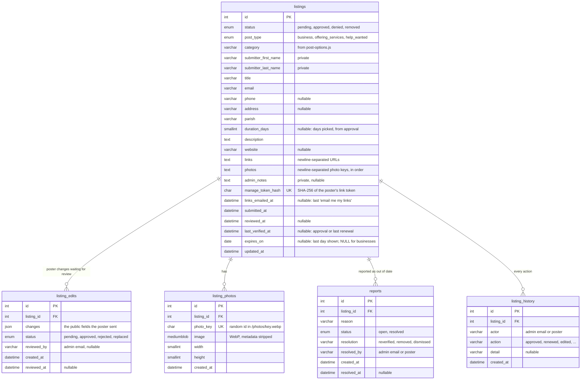

# Database

Every table and column in [`database/schema.sql`](../database/schema.sql). GitHub (and VS Code
with a Mermaid extension) draws the diagram below. **Update it whenever `schema.sql` changes**,
in the same commit as the schema and its migration.

How the tables are used: [architecture.md](architecture.md#data-model).

Deleting a listing row deletes its edits, photos, reports and history (`ON DELETE CASCADE`).
The app itself never deletes listings: removing one only sets `status = 'removed'`.

## Migrations

`schema.sql` creates the tables in an empty database. A database created before a change
needs that change's file from [`database/migrations/`](../database/migrations/), run once, in
date order. Each file says which change it belongs to.
